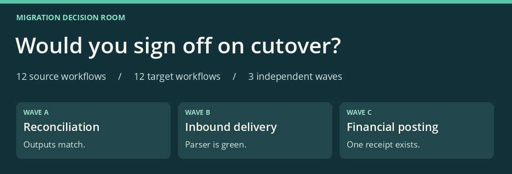
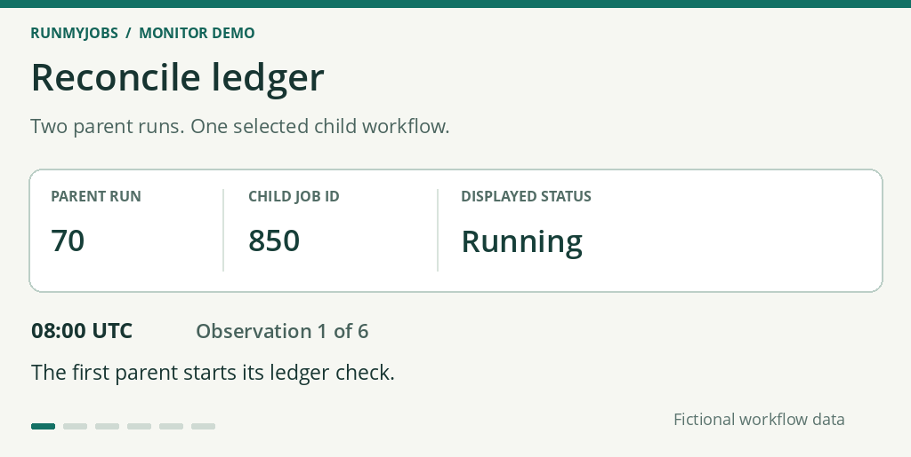

# Jagadeesh Gadimuthaka · RunMyJobs migration engineering

I’m a former Redwood Professional Services consultant. I build SAP and non-SAP workflows in RunMyJobs, extract scheduling controls from source and target systems, and give operators a way to trace failures to the exact execution. My migration work spans scheduler semantics, application integration, release tooling and operational handover.

## Would you release this migration wave?

**Twelve source workflows. Twelve target workflows. All twelve mapped.** One wave is ready for a controlled cutover, one starts on yesterday’s file, and one may already have posted a financial transaction. Can you tell which is which from the handover?

[Take the four-decision cutover rehearsal](cutover-rehearsal.md) · [Download the branching PDF](migration-decision-room.pdf) · [Inspect the 12-row evidence ledger](rehearsal-evidence.csv) · [Read the shift handover](cutover-handover.md)

The rehearsal uses invented workflows and observations. It demonstrates how I reason about release risk. The project cases below describe work I carried out.

## What I built

| If you need someone to… | What I can walk you through |
| --- | --- |
| Determine whether a migration preserves business behaviour | I built the RMJ configuration extractor in Java/RedwoodScript, the AutoSys JIL parser in Python, and the comparison reports used to review behavioural differences. [Migration audit](autosys-migration.md) · [Sample findings](migration-review.csv) |
| Orchestrate a chain across SAP and enterprise applications | I worked across ECC, BODS, Salesforce, webMethods, Datasphere, BTP CPI and CIDS. The Salesforce and webMethods trigger tests returned both HTTP and application-level acknowledgements. [Integration case](cross-system-orchestration.md) |
| Move RMJ objects through a controlled release | I worked on related-object export to Azure Repos and the PowerShell step that sent an existing CAR archive from Azure Pipelines. The upload worked. Import validation remained limited. [Release case](azure-devops-releases.md) |
| Give operators a reliable execution to investigate | I enhanced an existing monitor so operators could follow a selected subchain and open its native Process view. [Monitor case](nested-workflow-monitoring.md) · [Visual replay](workflow-monitor-replay.gif) |
| Route failures to the right team | I developed configuration-driven email and incident routing around Redwood’s ServiceNow connector, including parent/child notification handling. [Incident routing](notification-routing.md) |
| Deliver reports outside the scheduler | I linked RMJ report output, attachment selection, email and Power Automate routing. Email and the first flow were confirmed in testing. [SharePoint delivery](report-delivery.md) |

## Explore by engineering problem

- **Delivery leadership.** [How I would lead the first wave](migration-delivery-plan.md). Pilot selection, effort sizing, ownership transfer, first-live reconciliation and the measures I would put in front of a sponsor.
- **Migration architecture.** [18 checks across AutoSys, UC4/Automic and IBM TWS/IWS](migration-field-guide.md). Each check identifies a concrete input and what a reviewer must observe to accept a mapping.
- **Build, integration and support.** [Engineering work by discipline](engineering-practice.md). Covers SAP ABAP and BW, execution controls, remote APIs, promotion, operator monitoring and incident ownership.
- **Production diagnosis.** [SAP Datasphere connection investigation](datasphere-connectivity.md). See which DNS, TCP and TLS checks passed, and which application question remained open.
- **Executive introduction.** [Two-page project brief](Jagadeesh_RunMyJobs_Portfolio_Brief.pdf).

## Workflow monitor replay

At 08:07 UTC the correct row is parent 71, child 810, **Waiting for input**. A late completion for 850 and a stale message for 810 must both leave that result intact. The completed child remains visible after 08:12.

The public materials are case studies and demonstrations. Implementation source is private. To request an interview walkthrough or discuss a specific source review, [contact me on LinkedIn](https://www.linkedin.com/in/jagadeeshrmj/). Any source review requires my explicit approval.
